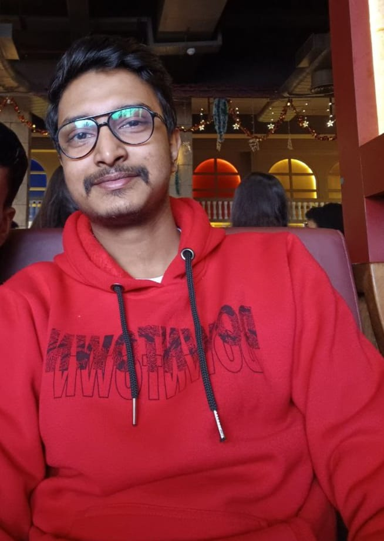
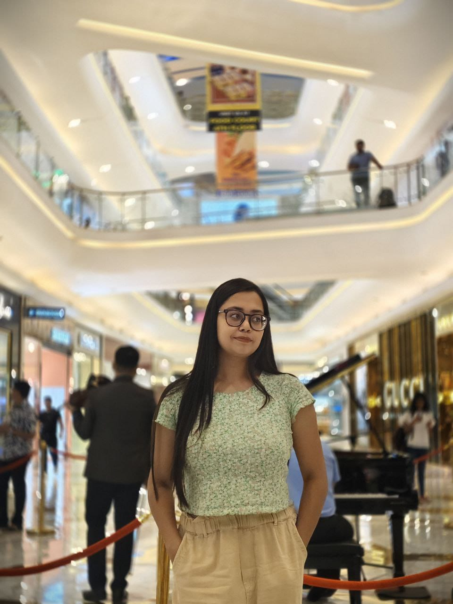
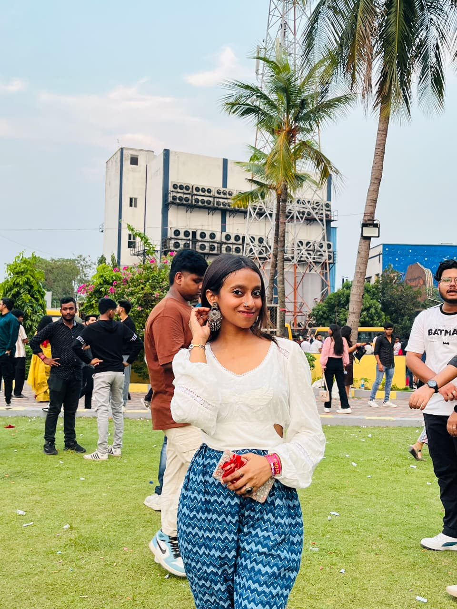

<p align="center">
  <br>
  <b style="font-size:2em;">Fabricanova : Reinventing Style with AI</b><br><br>
  <a href="https://your-live-demo-link.com"><b>Live</b></a> &nbsp; | &nbsp;
  <a href="LICENSE"></a>
  <a href="https://github.com/NiT Kolkata/fabricanova-os/releases"></a>
</p>

**The Neural Loom for Modern Fashion Design**

Fabricanova OS is an AI-powered platform for fashion designers, blending generative AI, technical sketching, and collaborative tools. Built with Next.js, React, and Python, it enables users to create, visualize, and iterate on garment designs from concept to technical vector sketches.

---

## Features

- **AI Fashion Studio**: Generate garment designs from text prompts and sketches using advanced diffusion models.
- **Interactive Canvas**: Draw, upload, and edit technical sketches with real-time feedback.
- **Modern UI**: Responsive, accessible, and visually appealing interface built with Tailwind CSS and React.

---

## Modern Tech Stack

| Category      | Technology & Icon                                                                                   | Purpose/Role                                 |
|---------------|-----------------------------------------------------------------------------------------------------|----------------------------------------------|
| **Frontend**  |  Next.js <br>  React | UI, Routing, SPA/SSR                         |
| **Styling**   |  Tailwind CSS | Utility-first CSS framework                  |
| **Animation** |  Framer Motion | UI Animations                                |
| **Icons**     |  lucide-react | Iconography                                  |
| **Backend**   |  Python <br>  FastAPI | AI model serving, API endpoints              |
| **AI/ML**     |  PyTorch <br>  Diffusers <br>  OpenCV <br>  PIL | Generative models, image processing  |
| **Notebook**  |  Jupyter Notebook | Model training, prototyping                  |
| **Deployment**|  Vercel <br>  ngrok | Hosting, tunneling AI endpoints              |
| **Versioning**|  Git <br>  GitHub | Source control, collaboration                |

---

## Directory Structure

```
.
├── aitrain.ipynb           # Jupyter notebook for AI model training and inference
├── geometry.py             # Geometry calculations for garment sketches
├── sketch.py               # SVG sketch generation script
├── design.json             # Example design data
├── fabricanovaOS/          # Main Next.js frontend app
│   ├── app/                # Application pages (Studio, Auth, Pricing, Team, etc.)
│   ├── component/          # Reusable React components
│   ├── public/             # Static assets
│   ├── ...                 # Config, build, and type files
├── fashionAI/              # Python virtual environment for AI backend
├── sketches/               # Generated or sample sketches
└── Readme.md               # Project documentation
```

---

## Getting Started

### Prerequisites

- **Node.js** (v18+)
- **Python** (v3.8+)
- **CUDA GPU** (for AI model acceleration, optional but recommended)

### Installation

1. **Clone the repository:**
   ```sh
   git clone https://github.com/your-org/fabricanova-os.git
   cd fabricanova-os
   ```

2. **Frontend Setup:**
   ```sh
   cd fabricanovaOS
   npm install
   ```

3. **Backend (AI) Setup:**
   ```sh
   cd ..
   python3 -m venv fashionAI
   source fashionAI/bin/activate
   pip install -r requirements.txt
   ```

---

## Usage

### Start the Frontend

```sh
cd fabricanovaOS
npm run dev
```
Visit [http://localhost:3000](http://localhost:3000) to access the app.

### Run AI Backend (Jupyter/Colab)

- Open `aitrain.ipynb` in Jupyter or Google Colab.
- Follow notebook instructions to start the AI server (usually exposes a `/generate` endpoint via ngrok).
- Paste the ngrok URL into the Studio’s AI Server Config panel.

---

## Meet Our Team 

<table>
  <tr>
    <td align="center">
      <br/>
      <b>Sudipta Sarkar</b><br/>
      Project Lead / Web & ML
    </td>
    <td align="center">
      <br/>
      <b>Avirup Guha Biswas</b><br/>
      Web Assist /Focus
    </td>
    <td align="center">
      <br/>
      <b>Reema Das</b><br/>
      Designer/UI&UX
    </td>
    <td align="center">
      <br/>
      <b>Swagata Lahiri</b><br/>
      Designer and Tester/UI
    </td>
  </tr>
</table>

---

## Please Remember

**This project is developed strictly as an academic group major project and is intended solely for educational and research purposes. It is not designed, licensed, or intended for any commercial use**

---

## License

This project is licensed under the MIT License.

---

## Acknowledgements

- Built in NiT Kolkata buy our team
- Powered by open-source ML and the global fashion tech community.
